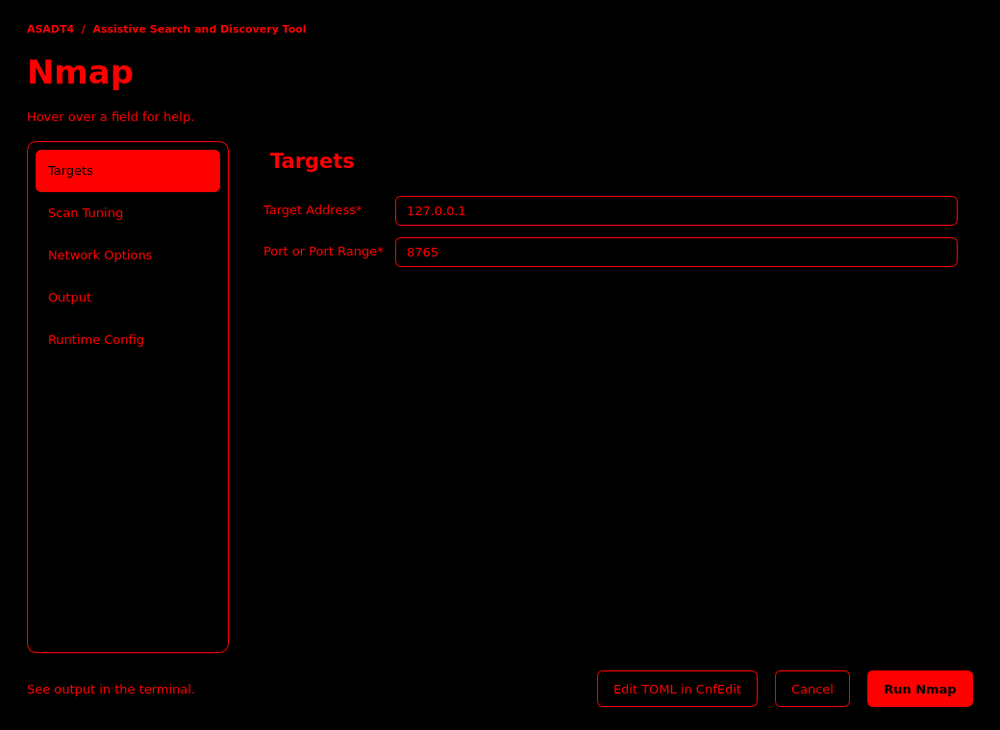
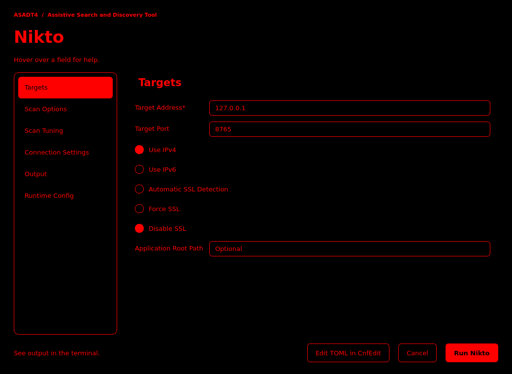

# ASADT4 | Assistive Search and Discovery Tool

```text
   █████╗  ███████╗  █████╗  ██████╗  ████████╗
  ██╔══██╗ ██╔════╝ ██╔══██╗ ██╔══██╗ ╚══██╔══╝
  ███████║ ███████╗ ███████║ ██║  ██║    ██║
  ██╔══██║ ╚════██║ ██╔══██║ ██║  ██║    ██║
  ██║  ██║ ███████║ ██║  ██║ ██████╔╝    ██║
  ╚═╝  ╚═╝ ╚══════╝ ╚═╝  ╚═╝ ╚═════╝     ╚═╝
  Assistive Search And Discovery Tool v4.0.1

  Happy Hacking ;P
```

ASADT4 (Assistive Search and Discovery Tool) is a Python toolkit for Kali Linux and Parrot OS. Its graphical interface makes it easier to configure and run security programs and scripts without typing lengthy commands or remembering each tool’s command-line options.

For example, to scan your computer with Nmap, enter the address and ports in the form. You can hover over a field for help. When you click **Run**, ASADT4 builds the command from your choices and runs your installed copy of Nmap. You can also run tools from the terminal, as shown below.

**Coming from ASADT3?** Version 4.0.1 adds eight tools, replaces the PySimpleGUI forms with PySide6, and lets you run all eleven tools directly from the terminal. [Full changelog and upgrade notes](CHANGELOG.md)

| Nmap targets | Nikto targets |
| --- | --- |
| [](.github/images/nmap-gui.png) | [](.github/images/nikto-gui.png) |

## Install on Kali Linux or Parrot OS

Use Python 3.10 or newer. Download or clone ASADT4, then open a terminal in the folder containing `asadt.py`.

```bash
sudo apt update
sudo apt install python3 python3-venv libegl1 libopengl0 libxcb-cursor0
python3 -m venv .venv
source .venv/bin/activate
python -m pip install -r requirements.txt
```

From the same folder, install the external tools that ASADT4 runs on Kali Linux or Parrot OS:

```bash
sudo .venv/bin/python asadt.py update --apt-dep-update
```

This command refreshes the APT package index, then downloads and installs the tool packages listed under `[APT_DEP]` in `config/scriptinfo.toml`. Use the virtual environment's Python with `sudo` so ASADT4 can load its Python dependencies and APT can install the system packages.

List the tools you can launch with ASADT4:

```bash
python asadt.py run
```

When you return in a new terminal, open the project folder and run `source .venv/bin/activate` again.

## Run your first scan

This command checks ports 80 and 443 on `127.0.0.1` (your own computer). The default Nmap scan needs elevated privileges, so use `sudo` with the Python interpreter from the virtual environment.

```bash
sudo .venv/bin/python asadt.py run nmap --target 127.0.0.1 --ports 80,443 --script http-title --output-dir reports
```

If ASADT4 asks to create the `reports` folder, enter `y`. Read the results in the terminal or open `reports/nmap-fullscan_output.txt`. A port marked `closed` means no service was listening on it when Nmap checked.

## Use the desktop form

From a graphical desktop session, run `python asadt.py run nmap`. If prompted, choose to open the form with your current permissions.

1. Enter `127.0.0.1` as the target and `80,443` as the ports.
2. To scan as a regular user, select **TCP Connect Scan** under **Scan Method** and clear **Assume Privileged Nmap Execution** under **Runtime Config**.
3. Choose an output folder you can write to and click **Run**. Watch the results in the terminal that opened the form.

Form settings apply to that run. To save defaults for future runs, use `python asadt.py cnfedit`.

## More help

- Run `python asadt.py run --help` for terminal options.
- [Technical reference](docs/CODE-REFERENCE.md)
- [Report an issue](https://github.com/Onetrak-Digital-Forensics/ASADT4/issues)
- [GPL-3.0 license](LICENSE)
